<!-- ░░ L72_SYS // FEED_01 ░░  assets are generated by scripts/build.py -->

<picture>
  <source media="(prefers-color-scheme: dark)" srcset="https://raw.githubusercontent.com/Linus72/Linus72/main/assets/hero-dark.svg"/>
  <source media="(prefers-color-scheme: light)" srcset="https://raw.githubusercontent.com/Linus72/Linus72/main/assets/hero-light.svg"/>
  
</picture>

  <a href="https://gekkos.tech"><code>[ GEKKOS.TECH ]</code></a>&nbsp;&nbsp;
  <a href="mailto:info@gekkos.tech"><code>[ INFO@GEKKOS.TECH ]</code></a>&nbsp;&nbsp;
  <code>x. 5227 · y. 0804</code>

<picture>
  <source media="(prefers-color-scheme: dark)" srcset="https://raw.githubusercontent.com/Linus72/Linus72/main/assets/about-dark.svg"/>
  <source media="(prefers-color-scheme: light)" srcset="https://raw.githubusercontent.com/Linus72/Linus72/main/assets/about-light.svg"/>
  
</picture>

<picture>
  <source media="(prefers-color-scheme: dark)" srcset="https://raw.githubusercontent.com/Linus72/Linus72/main/assets/stack-dark.svg"/>
  <source media="(prefers-color-scheme: light)" srcset="https://raw.githubusercontent.com/Linus72/Linus72/main/assets/stack-light.svg"/>
  
</picture>

<picture>
  <source media="(prefers-color-scheme: dark)" srcset="https://raw.githubusercontent.com/Linus72/Linus72/main/assets/telemetry-dark.svg"/>
  <source media="(prefers-color-scheme: light)" srcset="https://raw.githubusercontent.com/Linus72/Linus72/main/assets/telemetry-light.svg"/>
  
</picture>

<picture>
  <source media="(prefers-color-scheme: dark)" srcset="https://raw.githubusercontent.com/Linus72/Linus72/output/github-contribution-grid-snake-dark.svg"/>
  <source media="(prefers-color-scheme: light)" srcset="https://raw.githubusercontent.com/Linus72/Linus72/output/github-contribution-grid-snake.svg"/>
  
</picture>

<picture>
  <source media="(prefers-color-scheme: dark)" srcset="https://raw.githubusercontent.com/Linus72/Linus72/main/assets/footer-dark.svg"/>
  <source media="(prefers-color-scheme: light)" srcset="https://raw.githubusercontent.com/Linus72/Linus72/main/assets/footer-light.svg"/>
  
</picture>
