<picture>
  <source media="(prefers-color-scheme: dark)" srcset="https://raw.githubusercontent.com/Linus72/Linus72/main/assets/hero-dark.svg?v=4"/>
  <source media="(prefers-color-scheme: light)" srcset="https://raw.githubusercontent.com/Linus72/Linus72/main/assets/hero-light.svg?v=4"/>
  
</picture>

<a href="mailto:linus@gekkos.tech">
<picture>
  <source media="(prefers-color-scheme: dark)" srcset="https://raw.githubusercontent.com/Linus72/Linus72/main/assets/panel-dark.svg?v=4"/>
  <source media="(prefers-color-scheme: light)" srcset="https://raw.githubusercontent.com/Linus72/Linus72/main/assets/panel-light.svg?v=4"/>
  
</picture>
</a>
